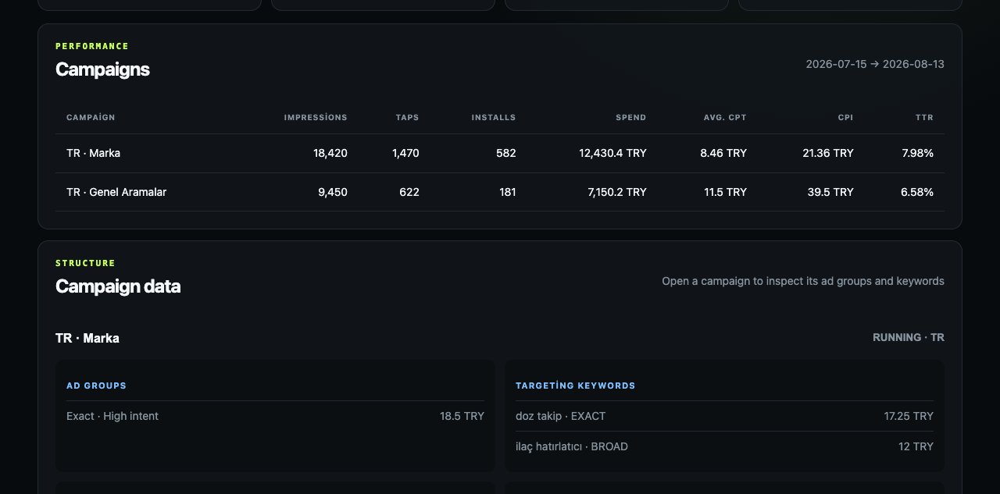

# Apple Ads API 5 Starter

[](https://github.com/Jarvis322/apple-ads-api-starter/actions/workflows/ci.yml)
[](https://github.com/Jarvis322/apple-ads-api-starter/actions/workflows/codeql.yml)
[](LICENSE)

A secure, read-only TypeScript starter for Apple Ads Campaign Management API 5. It handles OAuth 2 client credentials, fetches accounts, campaigns, ad groups, targeting keywords, and campaign performance reports, then displays the data in a lightweight dashboard.

> This is an independent community project. It is not affiliated with or endorsed by Apple.



## Features

- ES256 client-secret JWT generation from a P-256 private key
- One-hour access-token caching with an expiration safety margin
- Account/ACL, campaign, ad-group, and targeting-keyword reads
- Campaign, ad-group, keyword, and search-term reporting by date range
- Complete offset pagination instead of silently truncating at 1,000 records
- Request timeouts, bounded exponential backoff, and one-time token refresh
- Runtime response validation with Zod
- Impressions, taps, installs, spend, average CPT, CPI, and TTR overview
- Mock mode for local evaluation without Apple Ads credentials
- Optional HTTP Basic authentication, secure headers, and rate limiting
- An `AppleAdsGateway` boundary ready for a future optimizer
- No secrets sent to the browser, written to disk, or committed to Git

## Official API references

This project was checked against Apple's official documentation on August 13, 2026:

- API base: `https://api.searchads.apple.com/api/v5`
- OAuth token endpoint: `https://appleid.apple.com/auth/oauth2/token`
- Grant and scope: `client_credentials` and `searchadsorg`
- Client secret: ES256-signed JWT with `iss=teamId`, `sub=clientId`, and `aud=https://appleid.apple.com`
- API calls use `Authorization: Bearer …`; organization calls also use `X-AP-Context: orgId=…`

References: [Apple Ads](https://developer.apple.com/documentation/apple_ads), [Implementing OAuth](https://developer.apple.com/documentation/apple_ads/implementing-oauth-for-the-apple-search-ads-api), [Calling the API](https://developer.apple.com/documentation/apple_ads/calling-the-apple-search-ads-api), and [Campaign-level reports](https://developer.apple.com/documentation/apple_ads/get-campaign-level-reports).

## Getting Apple Ads API credentials

The five configuration values come from two places:

| Environment variable         | Where it comes from                                                       |
| ---------------------------- | ------------------------------------------------------------------------- |
| `APPLE_ADS_CLIENT_ID`        | Displayed by Apple after you upload a public key                          |
| `APPLE_ADS_TEAM_ID`          | Displayed by Apple after you upload a public key                          |
| `APPLE_ADS_KEY_ID`           | Displayed by Apple after you upload a public key                          |
| `APPLE_ADS_PRIVATE_KEY_PATH` | The local path where you create and securely store the private key        |
| `APPLE_ADS_ORG_ID`           | Returned by the Apple Ads `GET /api/v5/acls` endpoint; initially optional |

### 1. Grant an Apple Ads API role

Sign in to [Apple Ads](https://ads.apple.com/) with an account administrator, then open the advanced account interface. In **Account Settings > User Management**, invite or edit the user that will access the API.

For this read-only starter, choose **API Account Read Only** whenever possible. Use a read/write API role only if you later add reviewed and guarded mutation operations. If **Account Settings > API** is not visible, confirm that:

- the account uses Apple Ads Advanced;
- the signed-in user has an API-capable role;
- an account administrator completed the invitation and permissions setup.

Apple documents the role invitation as the first step in [Implementing OAuth for the Apple Ads API](https://developer.apple.com/documentation/apple_ads/implementing-oauth-for-the-apple-search-ads-api).

### 2. Generate the private/public key pair on macOS or Linux

Run the following commands outside the repository:

```bash
mkdir -p ~/.config/apple-ads
chmod 700 ~/.config/apple-ads

openssl ecparam \
  -genkey \
  -name prime256v1 \
  -noout \
  -out ~/.config/apple-ads/private-key.pem

openssl ec \
  -in ~/.config/apple-ads/private-key.pem \
  -pubout \
  -out ~/.config/apple-ads/public-key.pem

chmod 600 ~/.config/apple-ads/private-key.pem
```

This creates:

- `private-key.pem`: stays only on your machine or in your secret manager;
- `public-key.pem`: uploaded to Apple Ads.

Never commit either file. Never paste the private key, generated client-secret JWT, or access token into an issue, pull request, log, screenshot, or chat.

### 3. Upload the public key to Apple Ads

Open **Apple Ads > Account Settings > API**. Copy the complete public key, including its `BEGIN PUBLIC KEY` and `END PUBLIC KEY` lines.

On macOS, copy it directly to the clipboard:

```bash
pbcopy < ~/.config/apple-ads/public-key.pem
```

Paste it into the **Public Key** field and save. Apple then displays these credentials above the public-key field:

```text
clientId SEARCHADS.xxxxxxxx-xxxx-xxxx-xxxx-xxxxxxxxxxxx
teamId   SEARCHADS.xxxxxxxx-xxxx-xxxx-xxxx-xxxxxxxxxxxx
keyId    xxxxxxxx-xxxx-xxxx-xxxx-xxxxxxxxxxxx
```

These values are identifiers, but they should still be managed as configuration rather than embedded in source code.

### 4. Configure `.env`

Copy the example file and edit the local `.env` file:

```bash
cp .env.example .env
chmod 600 .env
```

Example:

```dotenv
APPLE_ADS_CLIENT_ID=SEARCHADS.xxxxxxxx-xxxx-xxxx-xxxx-xxxxxxxxxxxx
APPLE_ADS_TEAM_ID=SEARCHADS.xxxxxxxx-xxxx-xxxx-xxxx-xxxxxxxxxxxx
APPLE_ADS_KEY_ID=xxxxxxxx-xxxx-xxxx-xxxx-xxxxxxxxxxxx
APPLE_ADS_PRIVATE_KEY_PATH=/Users/your-name/.config/apple-ads/private-key.pem

# Optional for the first smoke test. Set it when you have multiple organizations.
# APPLE_ADS_ORG_ID=123456789

APPLE_ADS_MOCK=false
```

The starter reads the private key from the configured path, creates the ES256 client-secret JWT in memory, exchanges it for an access token, and never sends either secret to the browser.

### 5. Discover and select `orgId`

The live smoke test first calls `GET /api/v5/acls`, which does not require the `X-AP-Context` organization header. If `APPLE_ADS_ORG_ID` is absent, the command uses the first accessible organization:

```bash
npm run smoke:live
```

The output contains counts, not credentials. To inspect accessible organizations in the local dashboard, start the app and use `GET /api/accounts`. When your Apple Ads user can access multiple organizations, set the intended numeric identifier explicitly:

```dotenv
APPLE_ADS_ORG_ID=123456789
```

Apple requires `X-AP-Context: orgId=…` for organization-scoped calls, as described in [Calling the Apple Ads API](https://developer.apple.com/documentation/apple_ads/calling-the-apple-search-ads-api).

### Windows key generation

Use OpenSSL from Windows Terminal, Git Bash, or WSL and store the key outside the repository. Set `APPLE_ADS_PRIVATE_KEY_PATH` to an absolute Windows path such as `C:\\Users\\your-name\\.config\\apple-ads\\private-key.pem`. Do not use the macOS-only `pbcopy` command; open `public-key.pem` in a text editor and copy the complete public key instead.

## Quick start

Node.js 20.19 or newer is required.

```bash
npm install
cp .env.example .env
npm run dev
```

Fill in `.env` with your Apple Ads values, then open [http://localhost:3000](http://localhost:3000).

To try the dashboard without Apple credentials, set `APPLE_ADS_MOCK=true` in `.env`.

For an internet-facing deployment, configure both `DASHBOARD_AUTH_USER` and a long random `DASHBOARD_AUTH_PASSWORD`. Terminate TLS at a trusted reverse proxy and store all secrets outside the repository.

## Live API smoke test

After configuring real credentials, run a read-only smoke test:

```bash
npm run smoke:live
```

The command verifies OAuth, ACL access, campaign pagination, and a seven-day campaign report. It prints counts only and never prints tokens or private keys.

## Validation and production start

```bash
npm run check
npm run test:coverage
npm run build
npm start
```

## Local endpoints

| Local endpoint                                               | Apple API request                                                     |
| ------------------------------------------------------------ | --------------------------------------------------------------------- |
| `GET /api/accounts`                                          | `GET /api/v5/acls`                                                    |
| `GET /api/campaigns`                                         | `GET /api/v5/campaigns`                                               |
| `GET /api/campaigns/:campaignId/adgroups`                    | `GET /api/v5/campaigns/{campaignId}/adgroups`                         |
| `GET /api/campaigns/:campaignId/keywords`                    | `POST /api/v5/campaigns/{campaignId}/adgroups/targetingkeywords/find` |
| `GET /api/reports/campaigns?start=YYYY-MM-DD&end=YYYY-MM-DD` | `POST /api/v5/reports/campaigns`                                      |
| `GET /api/campaigns/:campaignId/reports/adgroups`            | `POST /api/v5/reports/campaigns/{campaignId}/adgroups`                |
| `GET /api/campaigns/:campaignId/reports/keywords`            | `POST /api/v5/reports/campaigns/{campaignId}/keywords`                |
| `GET /api/campaigns/:campaignId/reports/searchterms`         | `POST /api/v5/reports/campaigns/{campaignId}/searchterms`             |

You can append `?orgId=123` to local requests. If omitted, `APPLE_ADS_ORG_ID` is used. Identifiers are restricted to numeric values, and clients cannot provide arbitrary upstream Apple API paths.

## Security model

- `.env`, `*.pem`, `*.key`, and `client_secret.txt` are ignored by Git.
- The client-secret JWT is generated in memory and used only for the OAuth token request.
- Access tokens are cached in server memory and never logged or sent to the dashboard.
- Upstream error bodies remain server-side; clients receive a sanitized error and optional request ID.
- All included Apple Ads operations are read-only.
- Optional dashboard authentication, secure HTTP headers, and rate limiting are included. Production deployments still need TLS, centralized secrets, monitoring, and deployment-specific access control.

When adding bid or keyword mutation endpoints, use role checks, dry runs, per-change limits, human approval, and an immutable audit log.

## Optimizer roadmap

The Apple integration lives behind `AppleAdsGateway`. A safe next step is a metrics-normalization layer followed by a recommendation-only optimizer:

`recommendation -> dry run -> bid/budget guardrails -> human approval -> Apple PUT/bulk request -> audit record`

See [ROADMAP.md](ROADMAP.md) for planned optimizer guardrails, [CONTRIBUTING.md](CONTRIBUTING.md) for development guidelines, [CHANGELOG.md](CHANGELOG.md) for releases, and [SECURITY.md](SECURITY.md) for responsible disclosure.

## License

[MIT](LICENSE)
